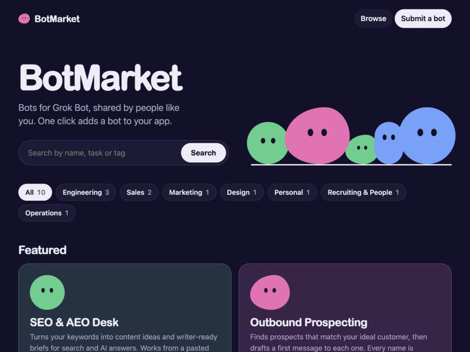
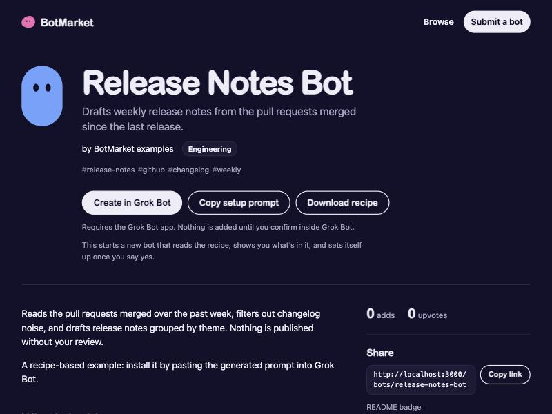

# BotMarket

A self-hosted marketplace for [Grok Bot](https://x.ai/bot) bots. People publish a bot with a description of what it does; anyone can add it to their own Grok Bot with one click. Your team, community or company gets its own catalog, backed by a single SQLite file, with no external services.





## How the one-click add works

Grok Bot registers the `grokbot://` URL scheme. Every template page at `https://x.ai/bot/<id>` has an "Add to Grok Bot" button that is really this deep link:

```
grokbot://app/v1/bot-template?id=<id>
```

The `id` is a 21-character id (`[A-Za-z0-9_-]`). An https universal-link equivalent also exists: `https://cursor.com/grok-bot/link/v1/bot-template?id=<id>`.

BotMarket builds these links only from validated ids. Clicking "Add to Grok Bot" opens the app's template import review. **Nothing is added to Grok Bot until the user confirms inside the app.**

There are two kinds of listings:

- **Template bots** point to an official Grok Bot template (`templateRef`). The button opens the template import review via the deep link above. "Open on x.ai" is the fallback if the app is not installed. Skills and plugins in a template are visible only inside the app's review, not on the web.
- **Recipe bots** publish their contents as open JSON (`grokbot-recipe/v1`). The button uses `grokbot://app/v1/prompt?text=<setup prompt>` (the prompt is at most 1000 characters). It opens a chat telling a new bot to fetch `/api/bots/<slug>/recipe.json` and set itself up: memories become journal memories, skills become skills, routines are created paused, and plugins are installed only after asking you.

`/add/<slug>` counts the click and then redirects (302) to the right deep link. It is what the badge and shared links use. `/add/<slug>?via=web` redirects to the x.ai page instead.

## Quick start

From source (Node.js 22.13 or newer):

```sh
git clone https://github.com/OWNER/grokbot-botmarket.git
cd grokbot-botmarket
npm ci && npm run build && npm start
```

With Docker:

```sh
docker build -t grokbot-botmarket .
docker run -d --name botmarket -p 3000:3000 -v botmarket-data:/data \
  -e BOTMARKET_ADMIN_TOKEN=change-me \
  -e BOTMARKET_PUBLIC_URL=https://bots.example.com \
  -e BOTMARKET_SEED=false \
  grokbot-botmarket
```

With Docker Compose:

```sh
docker compose up -d
```

Once the package is published to npm, `npx grokbot-botmarket` will also work.

Then open http://localhost:3000.

By default (`BOTMARKET_SEED=true`) an empty database is seeded with 10 example bots. Set `BOTMARKET_SEED=false` for a clean production instance.

## Publishing a bot

Open `/submit`.

1. **Template link.** Paste a template link (`https://x.ai/bot/<id>`, the `grokbot://` link, the cursor.com universal link, or the bare id). The server fetches the name, description and image, and prefills the form.
2. **Recipe.** Or paste or upload a recipe JSON. A bot's own export works unchanged.
3. Edit the fields (tagline, category, tags, longer description in Markdown) and publish.

If `BOTMARKET_REQUIRE_APPROVAL=true`, new bots stay pending until an admin approves them.

To get a template link, share the bot from Grok Bot (this requires your team's export policy to allow sharing).

## Recipe format

A recipe is the JSON a Grok Bot writes when asked to export its template:

```json
{
  "format": "grokbot-recipe/v1",
  "profile": { "name": "Release Notes Bot", "description": "Drafts weekly release notes from merged PRs.", "avatarShape": "capsule", "avatarColor": "blue" },
  "memory":   [ { "content": "Our release cadence is weekly on Thursdays.", "kind": "profile" } ],
  "skills":   [ { "name": "draft-release-notes", "description": "…", "content": "# Steps\n…" } ],
  "routines": [ { "name": "Weekly notes", "description": "…", "content": "Draft notes from PRs merged this week.", "schedule": "0 9 * * 4", "timezone": "Europe/Tallinn", "enabled": false } ],
  "plugins":  [ { "pluginId": "32661537", "name": "GitHub", "description": "Reads merged PRs" } ],
  "gettingStarted": { "skill": "draft-release-notes" },
  "setupNotes": "Needs read access to the repo."
}
```

Secrets, logins, conversation history and custom MCP servers are never part of a recipe. See [docs/recipe-format.md](docs/recipe-format.md) for every field, limit and accepted alias. Validate one locally with `grokbot-botmarket validate recipe.json`.

## README badge

Add this to your bot's README, replacing `YOUR-HOST` and `SLUG`:

```md
[](https://YOUR-HOST/add/SLUG)
```

## Configuration

| Variable | Default | Description |
| --- | --- | --- |
| `PORT` | `3000` | HTTP port. |
| `HOST` | `0.0.0.0` | Interface to bind. |
| `BOTMARKET_DATA_DIR` | `./data` | Directory for the SQLite database (`/data` in Docker). |
| `BOTMARKET_ADMIN_TOKEN` | unset | Enables `/admin` when set. Use a long random value. |
| `BOTMARKET_REQUIRE_APPROVAL` | `false` | Hold new submissions as pending until approved. |
| `BOTMARKET_SITE_NAME` | `BotMarket` | Name shown in the UI and OpenGraph tags. |
| `BOTMARKET_PUBLIC_URL` | unset | Public base URL. Recommended in production; used for absolute recipe and OpenGraph URLs. |
| `BOTMARKET_SEED` | `true` | Seed 10 example bots into an empty database. Set `false` for a clean production instance. |
| `BOTMARKET_TRUST_PROXY` | `false` | When `false`, rate limiting uses the socket IP and `X-Forwarded-*` headers are ignored for origins. Set `true` behind a reverse proxy. |

## CLI

The binary is `grokbot-botmarket` (the built-in help text calls it `botmarket`).

```
grokbot-botmarket serve                          # default
grokbot-botmarket import <catalog-url-or-file>   # import a catalog.json
grokbot-botmarket export [file]                  # write catalog.json (stdout if no file)
grokbot-botmarket validate <recipe.json>         # check a recipe
```

## API

JSON endpoints under `/api`, plus `/catalog.json`, `/add/:slug`, `/badge/:slug.svg` and `/healthz`:

```
GET  /api/bots?q=&category=&sort=new|top|installs&limit=&offset=   -> {bots, total}
GET  /api/bots/:slug
GET  /api/bots/:slug/recipe.json
POST /api/bots
POST /api/bots/:slug/upvote
GET  /catalog.json
```

Full reference: [docs/api.md](docs/api.md).

## Federation

`GET /catalog.json` exports every published bot in the `botmarket-catalog/v1` format. An admin can import another BotMarket's catalog from `/admin` (or with `grokbot-botmarket import <url>`), which upserts its bots by slug: a bot with the same slug is overwritten, keeping its existing status and featured flag. Run `grokbot-botmarket export` for a file backup.

## Security notes

Bots without an image use the default social image `/static/og-default.png` in OpenGraph tags.

- Deep links are built only from validated ids and URL-encoded text, never from raw user strings.
- Descriptions are Markdown rendered to sanitized HTML. Only `https:` image URLs are allowed.
- A Content-Security-Policy header is sent; there are no inline event handlers.
- Submissions are rate limited per IP (10 per hour; template lookups 30 per 10 minutes). Install clicks and upvotes are de-duplicated per IP per day rather than limited. Set `BOTMARKET_TRUST_PROXY=true` only behind a reverse proxy you control.
- Metadata is fetched server-side only from validated template ids, with a timeout and size cap.
- Admin routes require `BOTMARKET_ADMIN_TOKEN` (bearer header or signed cookie). Without it, `/admin` is disabled. Put the app behind HTTPS in production.

## Verified against Grok Bot 0.78.1 (macOS, 2026-10-31)

Checked against the app bundle and docs of Grok Bot 0.78.1:

- Template pages are `https://x.ai/bot/<21-char id>` and their button is `grokbot://app/v1/bot-template?id=<id>`.
- The app's deep-link router accepts the `grokbot:` and `sand:` schemes, the `/v1/bot-template` and `/v1/prompt` routes (prompt text up to 1000 characters), and the `https://cursor.com/grok-bot/link/v1/...` universal links.
- Template metadata is available without auth from `POST https://api2.cursor.sh/aiserver.v1.GrokBotService/GetPublicGrokBotTemplate`, with the x.ai page's OpenGraph tags as a fallback.
- The recipe shape matches the setup context the app gives a bot created from a template: routines created paused, plugins installed only after confirmation, memories as journal memories, skills as skills.

Grok Bot can change these details. If a link stops working, please open an issue.

## Development

```sh
npm ci
npm run dev        # run from source
npm test           # vitest
npm run typecheck  # tsc --noEmit
npm run build      # compile to dist/
```

See [CONTRIBUTING.md](CONTRIBUTING.md).

## License

MIT.

## Disclaimer

BotMarket is a community project. It is not affiliated with or endorsed by xAI or Cursor. "Grok" is a trademark of its owner. Bots listed in a BotMarket are the responsibility of their publishers; review a bot's contents before adding it.
